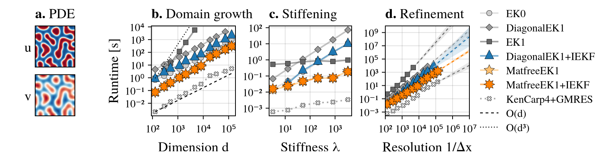

# Stable and Scalable Probabilistic Numerical Solvers for Stiff and High-Dimensional ODEs - Experiments

<p align="center">

</p>

This repo contains the experiment code for the paper
["Stable and Scalable Probabilistic Numerical Solvers for Stiff and High-Dimensional ODEs"](https://arxiv.org/abs/2606.08203), accepted at NeurIPS 2026.

---

__The [`MatfreeEK1`](https://nathanaelbosch.github.io/ProbNumDiffEq.jl/dev/solvers/#ProbNumDiffEq.MatfreeEK1) proposed in the paper is available in [ProbNumDiffEq.jl](https://nathanaelbosch.github.io/ProbNumDiffEq.jl/dev/).__
If you want to use it, use the package and not this repo.

---

## Running the experiments
Install the packages with Julia 1.13:
```sh
julia --project -e 'using Pkg; Pkg.instantiate()'
```

The experiments are in `./experiments/`.
In each folder, the `run*.jl` scripts write CSV files to `data/`, and the `plot*.jl` scripts make the figures from them.
The data of the paper is included, so you can make the figures without running anything:
```sh
julia --project experiments/1_fhn/plot.jl
```

| Folder | Figures |
|---|---|
| `1_fhn` | 1 |
| `2_dim_scaling` | 2 |
| `3_alpha_sweep` | 3 |
| `4_fixed_step` | 4 |
| `5_workprecision` | 5, 11 |
| `6_calibration` | 6, 8 |
| `7_probes_and_seeds` | 7 |
| `8_iteration_counts` | 9, 10 |

The top of each script says what it computes and how to call it.

## Reference
```bibtex
@misc{bosch2026stablescalableprobabilisticnumerical,
      title={Stable and Scalable Probabilistic Numerical Solvers for Stiff and High-Dimensional ODEs},
      author={Nathanael Bosch},
      year={2026},
      eprint={2606.08203},
      archivePrefix={arXiv},
      primaryClass={math.NA},
      url={https://arxiv.org/abs/2606.08203},
}
```
